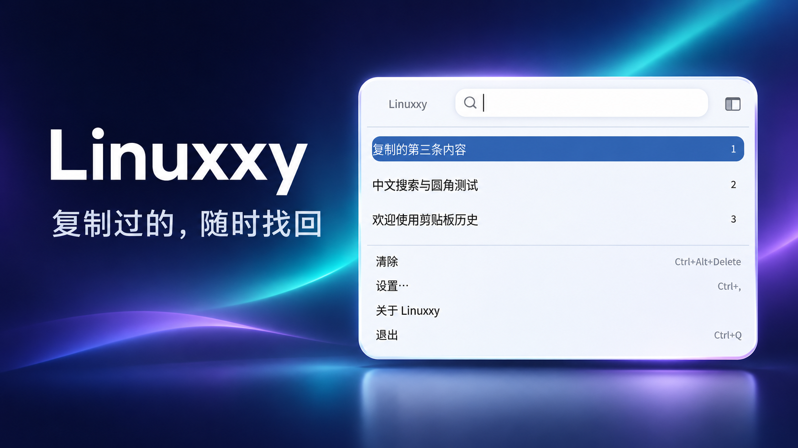
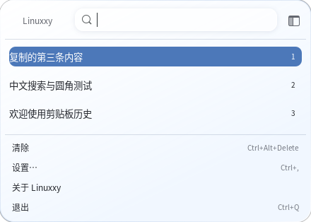
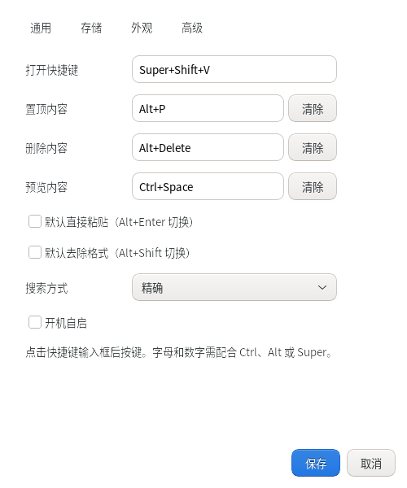
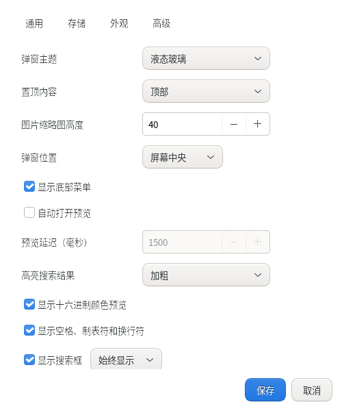
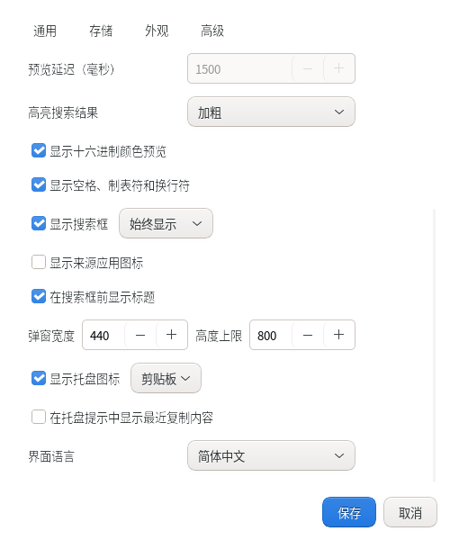
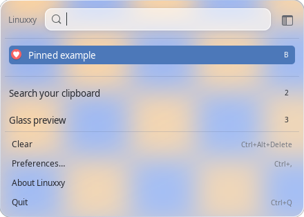
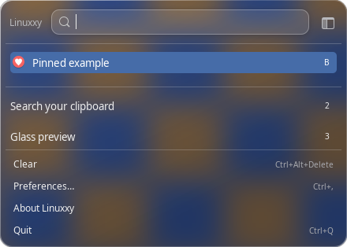
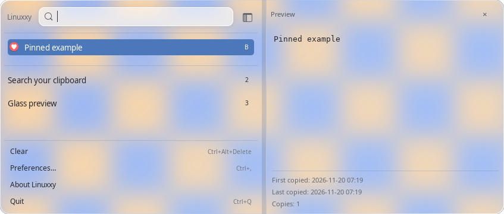
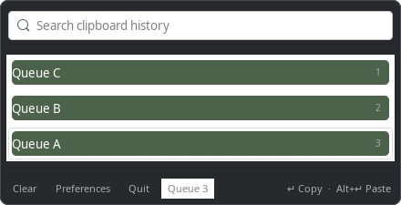

# Linuxxy

[English](README.en.md) · [下载 `.deb`](packages/linuxxy_0.1.1_all.deb) · [许可证](LICENSE)



> 上图是宣传视觉。下方截图来自程序实际运行界面。

Linuxxy 是一款面向 **Linux X11 桌面**的剪贴板管理器，受 [Maccy](https://github.com/p0deje/Maccy) 启发。复制文字、图片或文件后，按 **Super+Shift+V** 就能打开历史记录，搜索并再次复制或粘贴。

## 主要功能

- **快速找回**：保存文本、图片和文件记录；支持精确、模糊、正则与混合搜索。
- **顺手操作**：键盘快捷键、编号选择、直接粘贴、纯文本粘贴，以及多项粘贴队列。
- **整理历史**：置顶并拖动排序、编辑名称或文本、预览内容和清理记录。
- **贴合桌面**：简体中文与英文界面、液态玻璃与明暗主题、圆角弹窗、托盘运行和开机自启。
- **本地保存**：历史和偏好保存在当前用户目录，不需要联网服务。

## 界面截图

### 中文界面

| 剪贴板历史弹窗 | 通用设置 |
| :---: | :---: |
|  |  |

| 外观与液态玻璃选项 | 中文语言选项 |
| :---: | :---: |
|  |  |

### 主题、预览与批量粘贴

| 液态玻璃：浅色 | 液态玻璃：深色 |
| :---: | :---: |
|  |  |

| 侧边预览 | 多项粘贴队列 |
| :---: | :---: |
|  |  |

更多实际界面见 [screenshots](screenshots/)；[promo](promo/) 存放宣传图片。

## 安装

### Debian、Ubuntu、Linux Mint

下载 [linuxxy_0.1.1_all.deb](packages/linuxxy_0.1.1_all.deb)，在下载目录运行：

```sh
sudo apt install ./linuxxy_0.1.1_all.deb
```

`apt` 会安装所需的 Python 和 GTK 3 依赖。请在 X11 会话中使用；若中文显示缺字，可安装 `fonts-noto-cjk`。安装后从应用菜单启动 **Linuxxy**。

### 安装到用户目录

在 Debian 系发行版中，先安装运行依赖，再运行用户安装脚本。安装程序本身不需要管理员权限：

```sh
sudo apt install python3-gi gir1.2-gtk-3.0 python3-xlib python3-cairo python3-pil fonts-noto-cjk
python3 install.py
```

这会把程序安装到 `~/.local`。也可以直接运行 `python3 linuxxy.py`。从源码重新构建 `.deb`：`python3 packaging/build_deb.py`。

**从旧的用户安装版切换到 `.deb`：**先在托盘中退出 Linuxxy，再运行 `python3 ~/.local/share/linuxxy/install.py --uninstall`，然后安装 `.deb`。历史与偏好会保留。安装后在设置中将“开机自启”关闭再打开一次，以更新启动路径。

## 开始使用

1. 在任意程序中复制文字、图片或文件。
2. 按 **Super+Shift+V**，或点击托盘图标，打开剪贴板历史。
3. 输入关键词搜索；按 **Enter** 复制选中项，按 **Alt+Enter** 粘贴到之前的窗口。

| 操作 | 默认快捷键 |
| --- | --- |
| 打开历史 | **Super+Shift+V** |
| 预览选中内容 | **Ctrl+Space** |
| 置顶 / 删除选中内容 | **Alt+P** / **Alt+Delete** |
| 编辑选中内容 | **F2** |
| 多选后开始粘贴队列 | **Ctrl+Shift+Enter** |
| 打开设置 | **Ctrl+,** |
| 清除未置顶历史 / 清除全部历史 | **Ctrl+Alt+Delete** / **Ctrl+Alt+Shift+Delete** |

按住 **Super+Shift** 并重复按 **V** 可依次选中历史项。弹窗顶部空白区域、标题或预览标题可拖动；在设置中选择“上次位置”，下次即可在该处打开。常用内容可以置顶，并为置顶项分配字母快捷键。更多操作见 [英文详细说明](README.en.md#use)。

## 兼容性与数据

- 当前仅支持 **X11**；全局快捷键、自动粘贴和富格式恢复依赖 X11。Wayland 尚未支持。建议桌面提供系统托盘和合成器，以获得完整的托盘与液态玻璃效果。
- 历史存储在 `~/.local/share/linuxxy/history.sqlite`（或 `$XDG_DATA_HOME/linuxxy/history.sqlite`），偏好存储在 `~/.config/linuxxy/settings.json`（或 `$XDG_CONFIG_HOME/linuxxy/settings.json`）。历史数据库**未加密**。
- 液态玻璃背景在弹窗打开时截取一次，弹窗保持打开期间不会实时更新。

## 许可证

从 **0.1.1** 起，Linuxxy 自有代码采用 [PolyForm Noncommercial License 1.0.0](LICENSE)：在该许可条款下允许非商业使用、修改与分享；商业用途需要另行取得授权。这是**源码可查看的非商业许可**，不是 OSI 意义上的开源许可。

**0.1.0 及更早版本曾以 MIT 许可发布**；本次变更不会追溯撤回当时授予的权利。Maccy 原有的 MIT 版权与许可声明保留在 [LICENSE-Maccy](LICENSE-Maccy)，不受 Linuxxy 新许可限制。

## 开发与测试

项目使用 Python 3、GTK 3、PyGObject 和 python-xlib。可运行 `python3 tests/deb_package_smoke.py` 检查安装包；桌面交互测试及其他测试说明见 [英文文档](README.en.md#desktop-test)。
